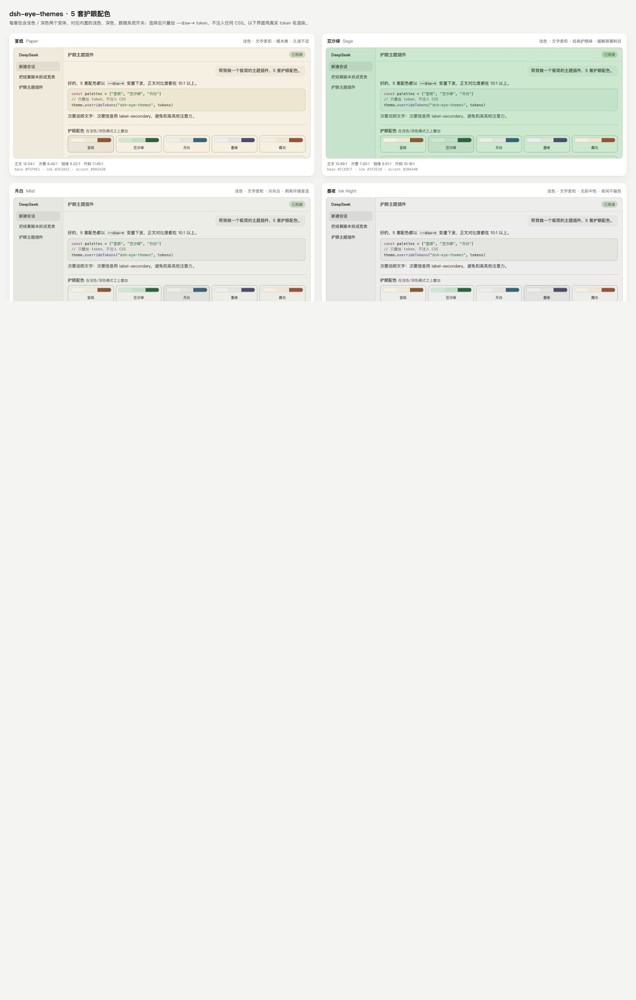

# dsh-eye-themes · 五套护眼主题

给 DeepSeek Harness 加五套护眼配色：**宣纸 / 豆沙绿 / 月白 / 墨夜 / 霞光**。
设置 → 通用里多一行选择器，点一下立即生效，不做别的。



（`preview/preview.html` 可以自己用浏览器打开，界面用真实 token 名渲染，深浅两组共 10 张卡片。）

## 它是什么

- **5 套配色，每套自带浅色 + 深色两个变体**。所以内置的「浅色 / 深色 / 跟随系统」照常可用，
  它决定当前显示哪一套的日间还是夜间版本，而不是被插件抢走。
- **只叠加 token，不注入 CSS**。每套配色是一层 `--dsw-*` 别名变量，交给内置 `theme` 服务
  （`overrideTokens`），由 `ui-layout` 的 presenter 写成 `<body>` 上的内联自定义属性。
  因此和任何第三方主题插件都能共存，卸载后不留残余样式。
- **一行 UI**。5 个色卡 + 一个「默认」，下面再跟一排「文字温度」三档（标准 / 柔和 / 更柔和）。
  没有滑块、没有字体和圆角开关。
- **深色下的白色文字默认不再刺眼**：所有比底色更亮的文字按配色自身的暖度向暖白收敛，
  正文对比度上限从 12–13:1 收到 **8.9–9.5:1**（默认「柔和」档），层级仍严格单调
  （正文 > 次要 > 三级），且任何一档都不会低于 7:1。
- 配色与文字温度都记在 `localStorage`（`dsh-eye-themes:palette` / `:text`），刷新后自动恢复；
  多窗口之间通过 `storage` 事件同步。「默认」＝撤掉这一层，回到内置配色。

## 文字温度（新增）

深色主题里最难受的往往不是背景，而是那行接近纯白的正文。三档文字温度就是调这个：

| 主题 | 标准 | 柔和（默认）| 更柔和 |
|---|---|---|---|
| 宣纸 Paper | 11.19:1 / `#ddd4c1` | 8.86:1 / `#c7bdab` | 7.51:1 / `#b8ae9c` |
| 豆沙绿 Sage | 10.97:1 / `#cdd7c8` | 9.46:1 / `#c0c8b8` | 7.99:1 / `#b1b8a9` |
| 月白 Mist | 11.43:1 / `#d0d5d7` | 9.04:1 / `#babec0` | 7.67:1 / `#acafb0` |
| 墨夜 Ink Night | 10.85:1 / `#c9c9cc` | 9.27:1 / `#bbbabc` | 7.77:1 / `#acaaad` |
| 霞光 Amber | 10.89:1 / `#d7c7b5` | 9.53:1 / `#cbbaa8` | 7.49:1 / `#b4a594` |

（表里是各套深色档的**正文**实测对比度与最终色值。）

规则只有两条，写在 `src/palettes.mjs` 里：

1. **只处理比底色更亮的文字**。浅色主题的深色正文原样保留——它不晃眼，不该被改。
2. **按「对比度目标」收敛，不是逐个 token 改颜色**。正文落在档位上限上，次要/三级按 0.76 / 0.60
   的固定比例跟随，所以层级数学上不会倒挂；链接不参与暖化（链接得看起来像链接），
   只跟着一起变暗，且保底 4.5:1。按钮/提示里压在强调色上的白字只暖化不压暗，
   否则会跌破可读性。

暖化用的是配色自己的 `textWarmth`：宣纸/霞光偏暖（0.30/0.34）所以白色会偏奶油，
月白/墨夜本来就冷（0.08/0.05）只去掉一点蓝味，不会变成橙色。

## 五套配色

底色与强调色如下；「正文对比度」列是**柔和档**下的实测值（`npm run verify` 每次重新校验，
任何一项跌破阈值即构建失败）。

| 主题 | 风格 | 底色（浅 / 深） | 主文字 | 强调色 | 正文对比度 |
|---|---|---|---|---|---|
| 宣纸 Paper | 暖米黄，久读不涩 | `#F5F0E1` / `#211F19` | `#2E2A22` | `#8A5A2B` | 12.54 / 12.86 |
| 豆沙绿 Sage | 经典护眼绿 | `#CCE8CF` / `#16231A` | `#1F2E20` | `#2B6440` | 10.89 / 12.70 |
| 月白 Mist | 冷灰白，明亮房间 | `#ECEDE7` / `#1A1D20` | `#2A2E2A` | `#33667A` | 11.71 / 12.23 |
| 墨夜 Ink Night | 无彩中性，夜间不偏色 | `#EDEDEB` / `#16171A` | `#26262A` | `#4B4E6B` | 12.86 / 12.61 |
| 霞光 Amber | 暖杏暮色，蓝光最少 | `#F6EDE0` / `#1D1512` | `#33281F` | `#9A5230` | 12.37 / 12.17 |

共同约束（`src/palettes.mjs` 顶部注释即规范）：

- 不用纯白底、纯黑字：浅色底固定在 `#ECEDE7`–`#F6EDE0`，深色底固定在 `#16171A`–`#211F19`，
  正文对比度封顶 14:1，避免长时间阅读的眩光；
- 正文 ≥ 7:1（AAA）、次要文字 ≥ 4.5:1、链接 ≥ 4.5:1、代码区文字 ≥ 7:1、语法高亮 ≥ 3:1；
- 强调色一律降饱和：护眼不是把界面刷成糖果色。

每套覆盖 **146 个 token**（`lib/palettes.json` 可逐条查阅，含每个 token 的浅/深两个值），
包括背景层次、边框、文字层级、按钮、交互态、Markdown/代码块、滚动条、状态色、diff、
菜单/提示/引导、侧栏与气泡，以及 `--shiki-*` 语法高亮与 `--dsw-static-*` 兜底色阶。

## 安装

```bash
# 从 GitHub 装（推荐，锁定提交）
dsh plugin --profile web add github:gusu980/dsh-eye-themes#<sha>

# 或克隆后本地装
git clone https://github.com/gusu980/dsh-eye-themes.git
dsh plugin --profile web add ./dsh-eye-themes
```

装完**重启 DSH Desktop / `dsh web`**，打开 设置 → 通用，在「外观」「字号大小」下面即可看到「护眼配色」。

本机（`web` profile）当前就是按 GitHub 提交装的，`package.json` 里记为：

```json
"dsh-eye-themes": "github:gusu980/dsh-eye-themes#f580d4458e5f0b91d6e01bb37ca0d8be6799b99c"
```

卸载：`dsh plugin --profile web remove dsh-eye-themes`（或从 `dsh.profile.bundles` 删掉该条目）后重启。
配色层随插件一起释放，不会留下覆盖样式。

## 开发

```bash
npm run build     # src/ → lib/client.js（ModuleLoader bundle）+ lib/palettes.json
npm run verify    # token 名对照真实主题表、10 个变体的对比度、bundle 行为自测
node tools/preview.mjs && open preview/preview.html   # 10 张卡片的静态预览
```

目录：

| 路径 | 作用 |
|---|---|
| `src/palettes.mjs` | 5 套配色的种子（每套浅/深各 10 个种子色）+ 146 token 的推导规则 |
| `src/color.mjs` | 混色 / 透明度 / 相对亮度 / WCAG 对比度，无依赖 |
| `src/client.mjs` | 客户端半身：叠层、持久化、设置行组件（手写，只 `require('react')`） |
| `src/row.css` | 设置行样式，全部使用应用自身 token，跟随当前主题 |
| `tools/build.mjs` | 生成 `lib/client.js` 与 `lib/palettes.json` |
| `tools/verify.mjs` | 契约与行为校验（见下） |
| `lib/index.js` | 宿主半身：空 `apply()`，只用于让 loader 行存在（客户端 bundle 靠它被发现） |

`verify.mjs` 会实际把 bundle 放进一个假的 ModuleLoader + 假 React 里跑一遍，断言（共 329 条）：
只注册一个 `settings.general.item`（id `eye-themes`，order 11.5，不覆盖内置行）、
选配色时只压一层且 token 齐全、换配色/换文字温度都是替换而不是叠加、
换温度不动任何背景与强调色 token、「默认」会释放这一层、卸载时释放、
刷新后配色与温度都能恢复、行内渲染出 5 个色卡 + 默认 + 3 个温度档。
另外逐档校验：正文不超上限、不破 AA 底线、层级单调、更柔和确实比标准更暗、浅色主题正文不被改写。

## 已知取舍

- 选择存在**本机浏览器**（`localStorage`），不走 Host 设置文档，所以不同浏览器/设备各记各的。
  这是刻意的：内置 `ui-theme` 的 `preference` 字段只接受 `light/dark/system`，
  第三方主题 id 无法写进去，而 `overrideTokens` 图层本来就不需要持久化在 Host 侧。
- 选中的配色会**同时作用于日间和夜间**（同一色系的深浅两版），
  所以切换系统的深色模式时看到的是这套配色的夜间版本，而不是回到原生黑白。
- 没有自定义调色、没有字体/圆角/动效开关 —— 刻意留白。要更多花样请用壁纸类插件，别塞进这里。
